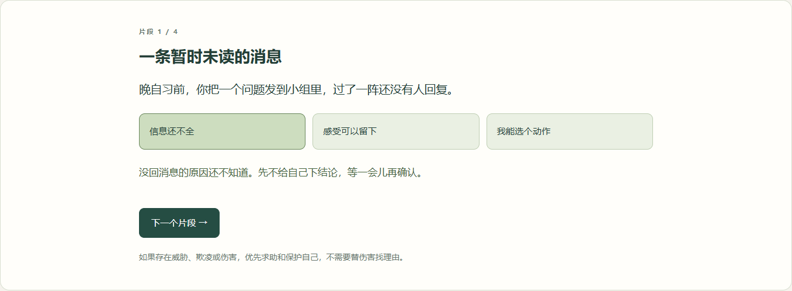

# MindCapsule 抱抱小刺猬

**校园情绪支持产品的公开展示 · Designed by ZHANG ZHELIN**

给初中生和高中生一个可以短暂停留、自然离开的空间。MindCapsule 以小刺猬、日常语言和轻量互动，探索公共触摸屏上的一般情绪支持。

本仓库展示现有项目的界面效果、设计思路与研究参考。**核心业务源码、人工安慰语句库和可安装软件不在此公开。这里是静态作品展示，不能启动聊天或运行小游戏。**

## 设计目标

- 不要求学生登录，让公共设备上的一次使用保持轻量。
- 聊天、笑话、天气小窗、暖心卡与小游戏提供不同的进入方式。
- 校园模式提供明显的结束按钮、Esc 清场与默认三分钟无操作清场。
- 不在公共设备提供个人聊天档案、小记保存或聊天导出。
- 保留人工创作的语气，同时明确规则式回应和现实求助的边界。

现有聊天使用本地规则与有限话题上下文，不是云端大语言模型。产品不承担心理诊断、治疗、危机筛查或自动救援功能。没有真人实时值守，也不代表已经完成学校现场或临床效果验证。

## 四个小游戏

### 流光轨道

按自己的节奏点亮六盏灯，可选节奏提示、随时停止。不计速度分，不输出情绪或能力评价。

### 书包减负

把预设的日常事项放入“现在能做一点”“可以找人一起”“暂时不必解决”三个口袋，支持撤回。不要求输入私人经历。

### 窗边拼图

通过点击旋转拼块还原窗景，没有倒计时或失败惩罚，可以使用提示或直接离开。

### 换个镜头

浏览四段原创校园片段，尝试不同解释角度。没有唯一正确答案，不生成心理测评结果。

## 三个版本的当前阶段

| 版本 | 私有开发项目的现状 | 此公开仓库提供什么 |
|---|---|---|
| 浏览器版 | 已有可运行的校园界面与功能 | 界面截图、设计报告 |
| Windows 校园版 | 已构建 v0.9.0-beta 试点安装包；干净设备、卸载重装及升级仍待完整验收 | 产品介绍，不含安装包或启动脚本 |
| Android 版 | PWA 形态，尚非原生 APK | 设计说明，不含应用源码或 APK |

截图来自既有设计报告中的功能演示环境，展示预设界面，不是学生真实聊天记录或学校实地部署证明。截图不代表每个平台均完成实体设备验收。

## 设计报告

原报告按原字节复制，署名 **ZHANG ZHELIN**。报告中标注的“模拟设计日期”保留原样，不应当作实际研究或开发完成时间。校园自述为虚构复合场景，研究参考不等于本产品效果已经被证实。

| 报告 | 阅读版 | 可编辑版 |
|---|---|---|
| 项目整体设计 | [PDF](design-reports/project/MindCapsule-Project-Design.pdf) | [Word](design-reports/project/MindCapsule-Project-Design.docx) |
| 流光轨道 | [PDF](design-reports/games/Orbit-Design.pdf) | [Word](design-reports/games/Orbit-Design.docx) |
| 书包减负 | [PDF](design-reports/games/Bag-Design.pdf) | [Word](design-reports/games/Bag-Design.docx) |
| 窗边拼图 | [PDF](design-reports/games/Window-Puzzle-Design.pdf) | [Word](design-reports/games/Window-Puzzle-Design.docx) |
| 换个镜头 | [PDF](design-reports/games/Perspective-Design.pdf) | [Word](design-reports/games/Perspective-Design.docx) |

研究背景与局限见 [研究线索与设计边界](research/RESEARCH.md)。报告保留公开层面的交互与架构说明，具体运行能力以当前版本说明及实际验收为准。

## 公开展示内容

| 目录 | 内容 |
|---|---|
| screenshots | 首页和四个小游戏的原始界面截图 |
| design-reports/project | 整体项目设计报告，PDF 与 Word |
| design-reports/games | 四个小游戏设计报告，PDF 与 Word |
| research | 原有研究参考说明 |
| assets/icons | 项目图标 PNG 素材 |

本目录未包含 Python、JavaScript、HTML/CSS 应用文件、构建与启动脚本、安慰语句数据、学校/设备配置、聊天记录、数据库、日志、安装包、Git 历史或开发环境。网页视觉通过静态截图展示，无需运行核心程序。

天气功能在私有软件中需单独同意后请求外部服务；清除本地会话不表示第三方服务数据已删除。后续多学校部署、管理后台和匿名统计属于长期规划，不应描述为已交付能力。

© 2026 ZHANG ZHELIN · MindCapsule
