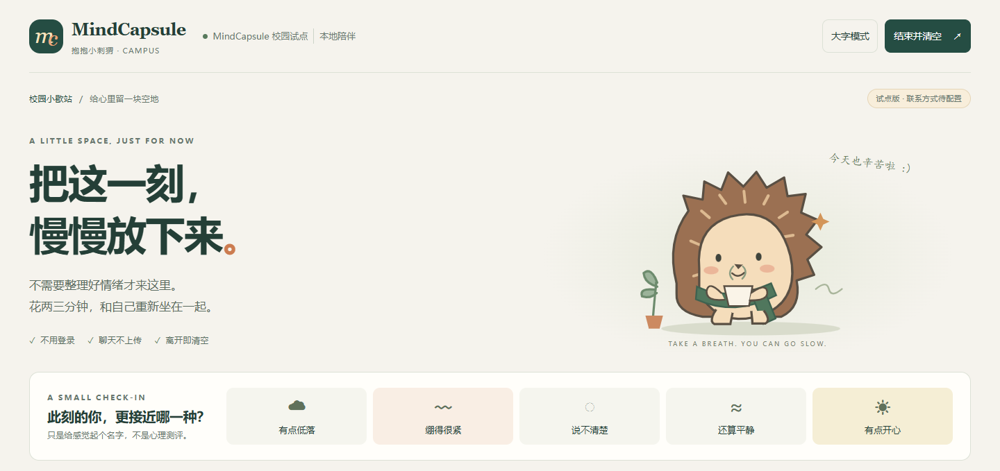
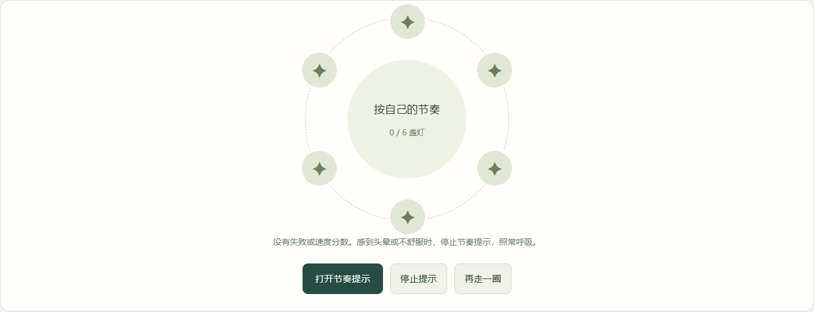
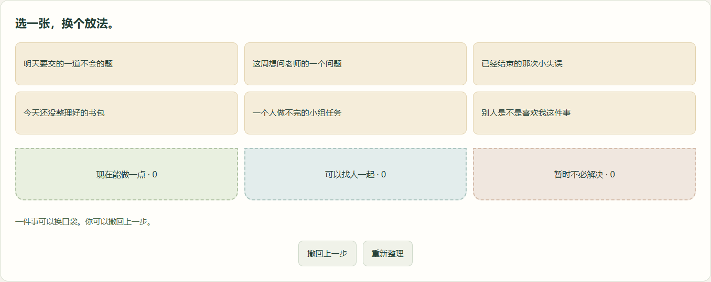

# 🦔 MindCapsule — Hug the Hedgehog

### An Emotional Support Companion for Adolescents

**抱抱小刺猬 · 青少年情绪胶囊**

**Designed by a student, for students.**

*Exploring human-centered computing, emotional expression, psychology-informed interaction, and privacy-conscious educational technology.*

**A little space for every feeling.**

English | 中文版（准备中）

[Project Demo](https://youtu.be/PUI62vXR5Xo) · [Original Project](https://github.com/prodigylinda/MindCapsule_Hugging-the-Hedgehog-previous) · [Developer](https://github.com/prodigylinda)

---

## Introduction

### MindCapsule — Hug the Hedgehog is an independent, student-led software project designed to make everyday emotional expression more approachable for middle school and high school students.



### The project was inspired by a simple problem observed in secondary education: students may experience academic pressure, frustration, social comparison, and self-doubt, yet hesitate to discuss these feelings openly.

MindCapsule explores how digital interaction can provide an additional, low-pressure space for reflection and general emotional support.

What began as a lightweight Python desktop application with a collection of human-written comforting messages has gradually developed into a multi-platform system featuring conversational support, everyday companion tools, interactive activities, and a dedicated campus touchscreen interface.

The long-term vision is to make MindCapsule suitable for responsible deployment in educational environments.

**MindCapsule is not a diagnostic, therapeutic, or emergency response system. It is designed to complement, not replace, human care and professional support.**

## Demonstration

### Project Video
This is the original video which was made when I began this project
a previous results shows.
▶ [Watch MindCapsule on YouTube](https://youtu.be/PUI62vXR5Xo)

*This video documents an earlier version of the project. Additional demonstrations of the campus application will be published as development progresses.*

### Application Gallery

Screenshots of the latest application will be added here after review.

Suggested gallery:

- Welcome screen
- Emotional conversation interface
- Interactive activities
- Windows campus touchscreen mode
- Personal desktop application

---

## Recent Updates

### November 2026 — Campus Mode Development

The project has expanded beyond the original Tkinter application to include browser-based interfaces and a Windows touchscreen experience.

Recent development milestones include:

- A shared web application for browser-based and campus interaction
- A Windows Edge fullscreen kiosk launcher
- A browser-installable Android PWA
- Four interactive mini-games
- Session-ending controls for shared devices
- Automatic session clearing after a configurable period of inactivity
- Separation of the personal desktop journal from the shared campus experience
- Automated testing for selected session-isolation and regression scenarios
- Preservation of the original human-written comforting-message files

### Current Limitations

The project remains a campus pilot prototype.

A distributable Windows installer and a native Android APK have not yet been confirmed as completed releases.

Multi-school administration, centralized analytics, device registration, and controlled software updates are future development goals.

Real-world campus deployment will also require device testing, professional content review, institutional approval, and appropriate privacy safeguards.

---

## Features Implemented

### Emotional Interaction

- Text-based conversation
- Local rule-based response generation
- Limited conversational context
- Academic stress and self-doubt response scenarios
- Supportive responses for selected everyday emotional concerns
- User-selectable interaction approaches
- Human-written comforting messages
- General safety-related guidance and human-support references

### Daily Companion Features

- Lighthearted offline jokes
- Weather lookup with user-controlled network access
- Simple relaxation prompts
- Environmental observation activities
- Small, manageable action-planning interactions

### Interactive Activities

- #### Flowing Light Trail — 流光轨道
- 
- #### Lighten the Backpack — 书包减负
- 
- #### Window Puzzle — 窗边拼图
- 
- #### A Different Perspective — 换个镜头
- 
  This games is designed by AI&me,if there are things which is not suitable, please contact me through:zhangzhelin2010@gmail.com and tell me your advice.

### Campus Experience

- Touchscreen-oriented layout
- Large, accessible interaction controls
- Windows fullscreen launch
- No mandatory student login in the shared campus interface
- Manual session clearing
- Configurable inactivity timeout
- Separation between personal and shared-device storage behavior
- Browser-based offline resources where supported

### Personal Desktop Experience

- Python Tkinter interface
- Optional local mood journal
- User-controlled conversation export
- Local SQLite storage for explicitly saved journal entries
- Separate desktop conversation engine

---

## Supported Platforms

| Platform | Technology | Current Availability |
|---|---|---|
| Python Desktop | Python 3.10+, Tkinter, SQLite | Runnable desktop prototype |
| Web | HTML, CSS, JavaScript | Runnable local web application |
| Windows Campus | Local Python service + Microsoft Edge | Runnable fullscreen campus prototype |
| Android | Progressive Web App | Browser-installable after suitable HTTPS deployment |

All platforms are currently undergoing ongoing development and testing.

The web, Windows campus, and Android PWA interfaces share browser-based application resources. The original Tkinter desktop application remains a separate implementation.

---

## Four Interactive Mini-Games

MindCapsule includes four activities designed to make the application more approachable and interactive for adolescent users.

The games explore different forms of engagement, reflection, and interaction without presenting themselves as clinical interventions.

### 1. Flowing Light Trail — 流光轨道

An interactive activity exploring focused engagement and simple visual interaction.

The intended design direction is to create an approachable activity that does not require students to discuss their emotions directly.

### 2. Lighten the Backpack — 书包减负

A school-themed activity using the metaphor of a backpack to explore everyday burdens and the experience of managing pressure.

The interaction connects the game's visual theme to familiar student experiences.

### 3. Window Puzzle — 窗边拼图

A puzzle-based activity centered on visual interaction, manageable tasks, and short periods of focused engagement.

### 4. A Different Perspective — 换个镜头

An interactive activity exploring the idea that a situation can sometimes be considered from more than one perspective.

It reflects the project's broader interest in flexible thinking and non-judgmental self-reflection.

### Game Design Documentation

Each activity is accompanied by design documentation covering its intended purpose, interaction structure, implementation, and psychological rationale.

The games have not been established as clinically effective treatments. Their usability and potential benefits require further evaluation.

---

## Design Motivation

### Academic Pressure

Secondary education can involve intensive examinations, increasing subject complexity, and pressure to meet academic expectations.

A difficult problem may lead a student to question not only their understanding of the subject but also their personal ability.

### Social Comparison

Students may interpret a difference in learning speed as evidence of personal inadequacy.

For example, a student who struggles with spatial geometry while classmates appear confident may begin to think:

> Everyone else understands this. Why can't I?

This hypothetical situation illustrates one of the project's original design concerns: the relationship between academic difficulty, social comparison, and self-doubt.

### Emotional Expression

Some students may hesitate to share feelings of frustration, embarrassment, or anxiety because they fear negative judgments.

MindCapsule investigates whether a simple digital interface can offer an additional opportunity for expression and reflection.

### Why a Hedgehog?

The hedgehog symbolizes sensitivity, boundaries, and self-protection.

Its protective spines represent the difficulty of approaching others while feeling vulnerable.

In this project, the hedgehog communicates a simple principle:

**Emotional support should be available without pressure or judgment.**

---

## Technical Architecture

### Current System

The application currently uses local rule-based conversational mechanisms rather than remote large language model inference.

Its core interaction process is:

User Input → Text Processing → Rule-Based Interpretation → Response Selection → Interface Feedback

### Desktop Application

The original desktop architecture includes:

- `main.py` — Tkinter user interface
- `companion.py` — conversational logic and supportive responses
- `journal.py` — optional SQLite mood journal
- `weather_service.py` — weather-related requests
- `DATa.py` — original human-written comforting messages
- `tests/` — automated desktop tests

### Campus Application

The browser-based campus application includes:

- `index.html` — main application interface
- `app.js` — interaction flow and session management
- `engine.js` — browser-side conversational logic
- `games.js` — interactive activities
- `styles.css` and `games.css` — interface styling
- `sw.js` — service-worker resource handling
- `manifest.webmanifest` — PWA metadata
- `server.py` — local web service and configuration validation

The campus application also includes Windows launch scripts, deployment configuration, tests, and design documentation.

### Architecture Boundaries

The present campus interface primarily processes conversation content locally.

The personal desktop application allows explicitly requested journal storage and exports, while the shared campus experience is designed around temporary sessions.

Weather requests may communicate with external services following user-controlled access.

Server-hosted deployments, operating systems, browsers, and external services require independent privacy assessment before real-world use.

---

## Software and Installation

### Python Desktop

Requirements:

- Python 3.10 or later
- Tkinter support

Run from the project root:

```bash
python main.py
```

Run desktop tests:

```bash
python -m unittest discover -s tests -v
```

On Windows, the original application can also be started with `start.bat`.

### Windows Campus Mode

The current prototype is launched using:

```text
campus/start-windows-kiosk.bat
```

The launcher starts the local service and opens the campus interface in Microsoft Edge fullscreen mode.

**Current requirements:**

- Windows
- Python 3.10 or later
- Microsoft Edge
- The complete campus application directory

The current prototype is not yet a standalone installer.

### Web Application

From the `campus` directory:

```bash
python server.py
```

The local application is served at:

```text
http://127.0.0.1:8765/
```

The project also contains static deployment examples using Nginx and Docker.

Production hosting requires additional configuration, HTTPS, and deployment review.

### Android PWA

The Android version currently uses Progressive Web App technology.

Once the application is hosted on a suitable HTTPS endpoint, compatible Android browsers can offer installation to the home screen.

A native Android APK is not part of the currently verified release artifacts.

### School Deployment

The campus application is currently intended for controlled demonstrations and technical evaluation.

It should not be presented as a fully validated school mental health service.

---

## Privacy and Responsible Design

Privacy is a central design objective of MindCapsule.

### Conversation Data

The campus application is designed to keep conversational context temporary and clear the current session when the user finishes.

### Shared-Device Protection

The Windows campus interface includes:

- A visible session-ending action
- Manual session clearing
- Automatic inactivity clearing
- Separation of consecutive sessions
- Clearing of relevant temporary interaction state

Actual shared-device deployment still requires verification of keyboard behavior, operating-system recovery, browser configuration, and physical access controls.

### Personal Desktop Storage

The personal desktop application differs from the campus interface.

It supports:

- Explicitly saved local mood-journal entries
- Optional conversation export
- Local SQLite storage

These files are not automatically encrypted and should be protected appropriately.

### Operational Analytics

Centralized school analytics have not yet been implemented.

The proposed future analytics system would focus on aggregate operational information rather than private conversations or inferred psychological states.

### Responsible Use

MindCapsule does not:

- Provide clinical diagnosis
- Claim to measure psychological health accurately
- Replace licensed mental health professionals
- Automatically contact emergency services
- Guarantee detection of every crisis-related message
- Demonstrate clinical effectiveness

Students experiencing serious or persistent difficulties should seek appropriate assistance from trusted adults and qualified professionals.

---

## Development Documentation

The project includes design and development materials such as:

- Project design report
- Development process report
- Four individual game-design reports
- Campus deployment planning
- Implementation and testing records

Selected public documentation will be linked after review.

**Original demonstration:** [YouTube](https://youtu.be/PUI62vXR5Xo)

**Original development history:** [MindCapsule Previous Version](https://github.com/prodigylinda/MindCapsule_Hugging-the-Hedgehog-previous)

---

## Development Roadmap

### Completed Prototype Milestones

- [x] Original comforting-message application
- [x] Python desktop interface
- [x] Rule-based continuous conversation
- [x] Optional mood journal
- [x] Everyday companion tools
- [x] Browser-based campus interface
- [x] Windows fullscreen launcher
- [x] Android PWA structure
- [x] Four interactive mini-games
- [x] Campus session-clearing implementation
- [x] Initial technical and design documentation

### Under Development or Pending Verification

- [ ] Reproducible Windows installation package
- [ ] Native Android APK evaluation
- [ ] Real touchscreen hardware acceptance testing
- [ ] Professional review of psychological content
- [ ] Privacy and security review
- [ ] Student usability evaluation
- [ ] Verified school pilot deployment

### Long-Term Development Goals

- [ ] School and device management
- [ ] Privacy-conscious aggregate usage statistics
- [ ] Authorized administration dashboard
- [ ] Controlled software updates and rollback
- [ ] Multi-school configuration and maintenance
- [ ] Broader educational partnerships

These are planned milestones, not claims of completed functionality or established school adoption.

---

## Project History

MindCapsule began with a human-written collection of comforting messages and a lightweight Python implementation.

The early version focused on recognizing selected emotional expressions through text and responding with prepared supportive language.

Later development introduced:

- More structured interaction logic
- Continuous conversations
- Additional daily companion features
- Optional personal journaling
- Cross-platform campus interfaces
- Interactive activities
- Stronger shared-device session controls
- More systematic testing and documentation

The original version remains available as a record of the project's early development.

[Explore the Original Version](https://github.com/prodigylinda/MindCapsule_Hugging-the-Hedgehog-previous)

---

## Research and References

MindCapsule draws general design inspiration from research and educational discussions concerning adolescent well-being, emotional expression, coping, and human-computer interaction.

Relevant resources include:

- [World Health Organization — Mental Health of Adolescents](https://www.who.int/news-room/fact-sheets/detail/adolescent-mental-health)
- [UNICEF — Mental Health](https://www.unicef.org/mental-health)
- [Open-Meteo API Documentation](https://open-meteo.com/en/docs)

These references provide background context. They do not imply endorsement or validate the effectiveness of the application.

The research rationale for individual activities requires further review against relevant primary literature.

---

## About the Project

MindCapsule is an independent student-led project motivated by the desire to apply computing to a familiar problem in secondary education.

It represents an ongoing exploration of:

- Software engineering
- Human-computer interaction
- Psychology-informed product design
- Privacy-conscious computing
- Cross-platform application development
- Educational technology
- Responsible AI-assisted development

AI coding tools have assisted portions of implementation, debugging, documentation, and testing.

The project's original motivation, conceptual direction, and preserved human-written content remain important elements of its development history.

## Source Code and Intellectual Property

The main application source code is maintained in a private development repository.

This public repository is intended for project presentation, selected documentation, demonstrations, and development updates.

The original historical repository is maintained separately.

Public availability of project materials does not itself grant permission to reproduce or commercially exploit proprietary content beyond applicable law and any expressly granted licenses.

Third-party components and assets remain subject to their respective license terms.

## Collaboration

MindCapsule welcomes interest and feedback from educators, school technology administrators, researchers, and professionals working in adolescent well-being.

Potential areas for future collaboration include:

- User experience evaluation
- Psychological content review
- Campus touchscreen testing
- Privacy and accessibility review
- Educational deployment research
- Software reliability and maintenance

Please use the developer's GitHub profile to initiate contact.

**Developer:** [prodigylinda](https://github.com/prodigylinda)

---

**MindCapsule — Hug the Hedgehog**

*Technology with empathy. Designed for students, with students in mind.*
Created by zhangzhelin
